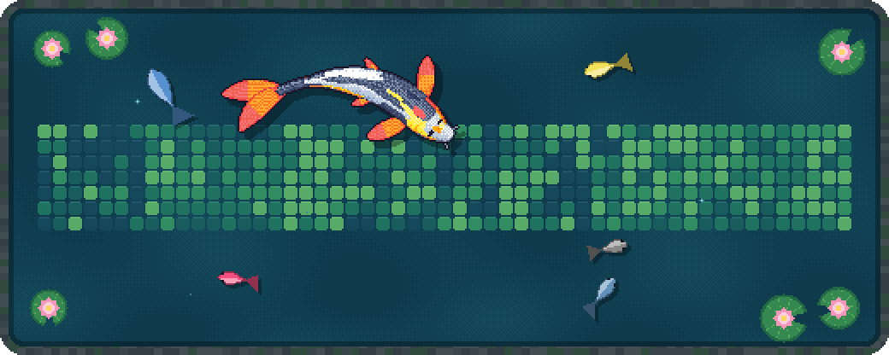

# Connor Love

Freelance web developer in Columbus, Ohio. I build custom websites, web apps, and interactive product experiences.

[connorlove.com](https://www.connorlove.com)

My pond is redrawn every night from my GitHub activity. The floor is my last year of contributions, each baby fish is a language I use, each pellet is a contribution from the past week, and each lily pad is a year on GitHub. They bloom while my streak runs. Built on [git-koi](https://github.com/yalongwastaken/git-koi).
